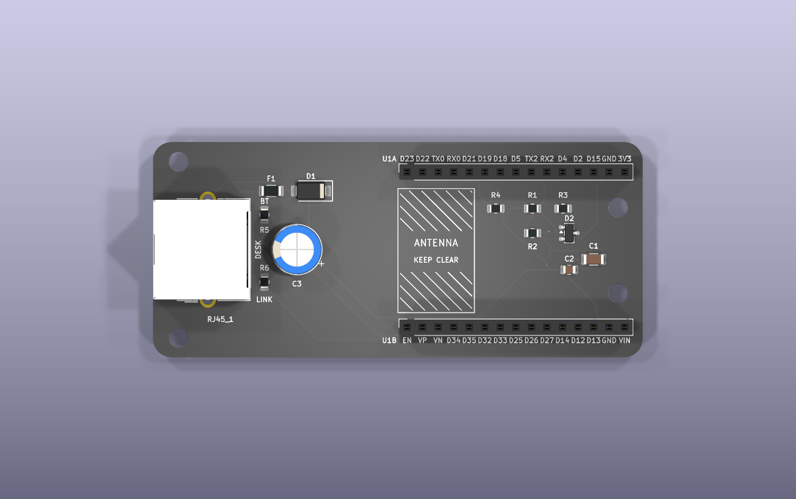
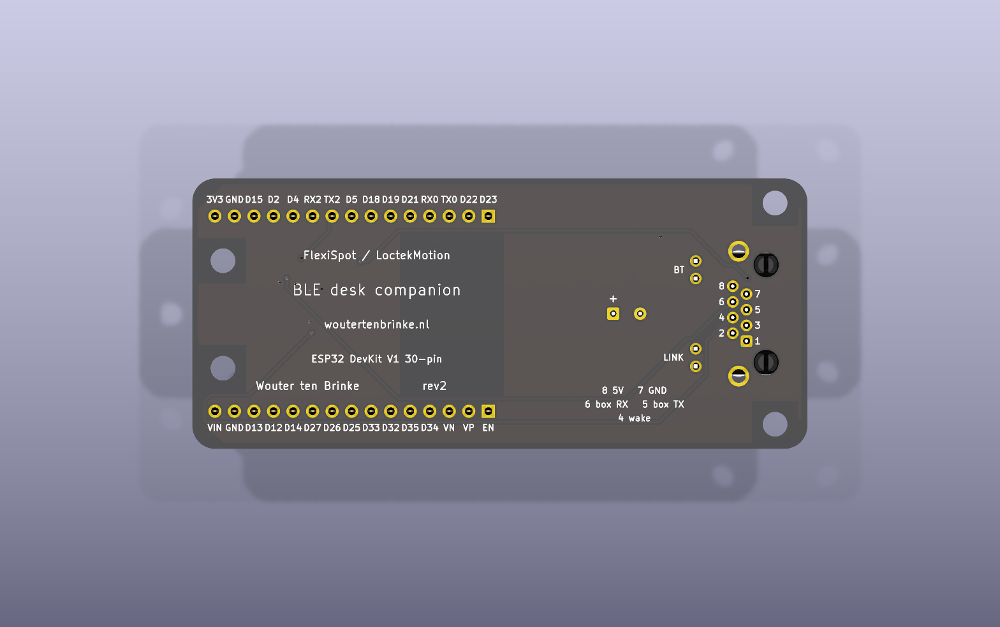
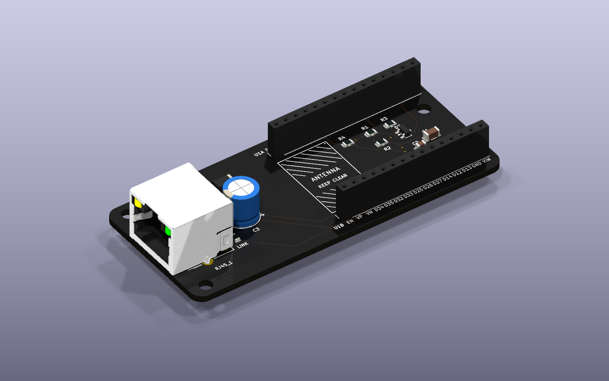
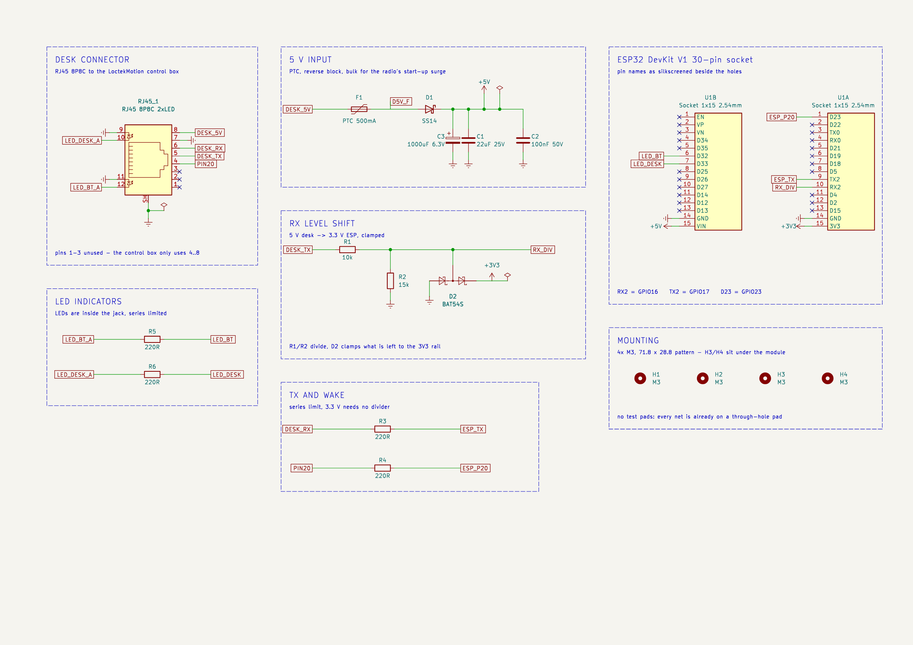
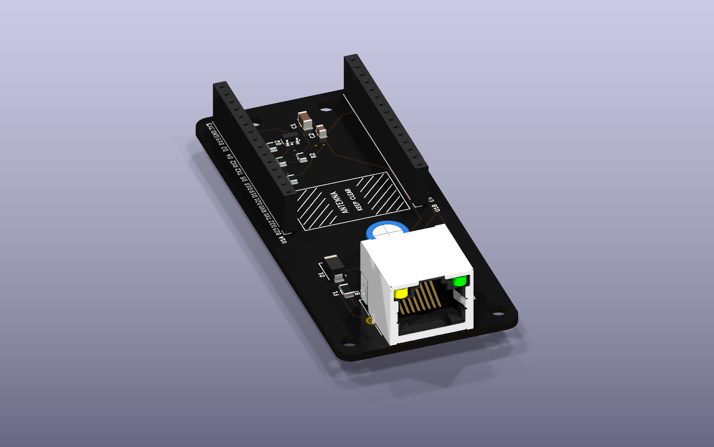
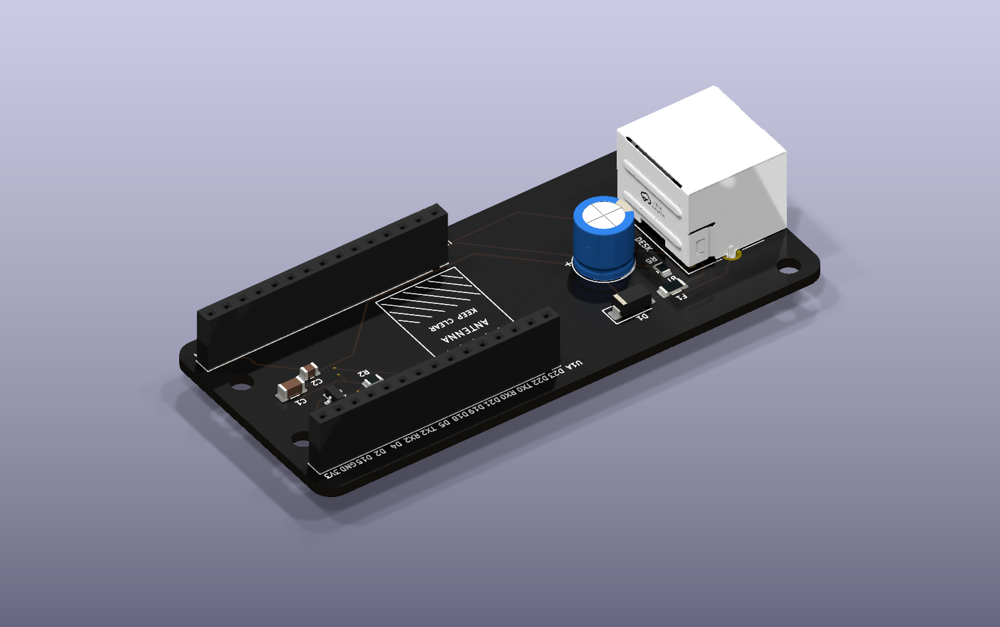

# Desk companion board

A carrier for an ESP32 DevKit V1 (30-pin) that plugs into a LoctekMotion / Flexispot control box over RJ45. It runs off the desk's 5 V, shifts the box's 5 V signal down for the ESP32, and uses the jack's two LEDs for Bluetooth (`BT`) and the desk link (`LINK`). What they show is in [getting started](../docs/getting-started.md#option-2-over-bluetooth-with-a-companion). The firmware is in [`../proxy`](../proxy).

| | |
|---|---|
|  |  |
|  |  |
|  |  |

Rev2, 80 × 35.2 mm, two layers, 4 × M3. The schematic is also a [PDF](fab/tab5-desk-ctrl-schematic.pdf).

## Wiring

| RJ45 pin | Control box | On the board | ESP32 |
|---|---|---|---|
| 8 | 5 V | PTC fuse, SS14 diode, 1000 µF | VIN |
| 7 | GND | ground pour | GND |
| 6 | box RX | 220 Ω | GPIO17 (TX2) |
| 5 | box TX, 5 V | 10k / 15k divider, BAT54S clamp | GPIO16 (RX2) |
| 4 | wake ("PIN 20") | 220 Ω | GPIO23 |
| 12 / 11 | LED | 220 Ω | GPIO32, `BT` |
| 10 / 9 | LED | 220 Ω | GPIO33, `LINK` |

This is how my control box uses pins 4 to 8: it sends on pin 5 and listens on pin 6, as the published LoctekMotion tables have it. Measure yours before plugging it in. The back of the board names what you probe there: the jack's pin numbers beside its pads with what each carries, `BT` and `LINK` by the LED pads, C3's + side, and the DevKit's pin names along both sockets, as on the top.

The companion firmware's defaults are this board's: TX on GPIO17, RX on GPIO16, wake on GPIO23.

## Ordering

Upload `fab/tab5-desk-ctrl-gerbers.zip`, `-bom.csv` and `-cpl.csv` to JLCPCB with SMT assembly on the top side. The jack, the two headers and C3 are hand-soldered, see `fab/tab5-desk-ctrl-hand-solder.csv`. Print `fab/tab5-desk-ctrl-check-1to1.pdf` at 100 % and hold the jack and the DevKit against it before you order.

## Files

The KiCad files are generated by the Python scripts here, so change the scripts rather than the board. `make_fab.sh` builds everything in `fab/`, and `render.sh` the pictures in `img/`. The scripts look for KiCad 9 where macOS puts it; `KICAD9_FOOTPRINT_DIR`, `KICAD9_SYMBOL_DIR` and `KICAD_CLI` point them elsewhere. The jack is LCSC part [C386757](https://www.lcsc.com/product-detail/C386757.html), where its datasheet is; its 3D model in `3dmodels/` is LCSC's.

## Things to know

- **Only for a box with 5 V on pin 8.** Nothing on the board protects against more: a LoctekMotion variant with about 29 V there destroys the capacitors, the DevKit's regulator and probably the ESP32.
- **C3 has a + side.** It is the 1000 µF electrolytic behind the jack, 8 mm across and no taller than 11.5 mm, its long leg in the pad marked +. It carries the radio's start-up surge: on desk power alone, rev1 browned out and restarted at every boot.
- **Rev1 had pins 5 and 6 the other way round.** On a rev1 board the companion needs TX on GPIO16 and RX on GPIO17, in `proxy/sdkconfig`, and R1 bridged, since commands to the box cannot pass its 10k. GPIO17 then takes the box's 5 V through 220 Ω, which is outside the ESP32's ratings.
- **The diode has to be a BAT54S.** The BAT54A and BAT54C come in the same package and both break RX without a sound: one holds the line near 0.6 V, the other keeps its low near 2.7 V. With the box idle, GPIO16 should read about 3.1 V.
- **Use flux made for electronics.** Acid flux for plumbing, such as S-39, leaves a residue that conducts: on a rev1 board it leaked about 6 kΩ from pin 6 to ground and held the box's signal down.
- **R2 is 15k.** The box's TX measured between 5.01 and 5.17 V; 10k over 15k puts that at 3.0 to 3.1 V, inside the ESP32's 3.3 V with room either side, whichever of those it is.
- **Pick the soldermask, silkscreen and finish on the order form.** JLCPCB does not read them from the files.
- **The LED polarity is from the jack's datasheet, not measured.** A LED that stays dark is the wrong way round, which does it no harm. At start-up the companion blinks `BT` twice, `LINK` twice, then both.
